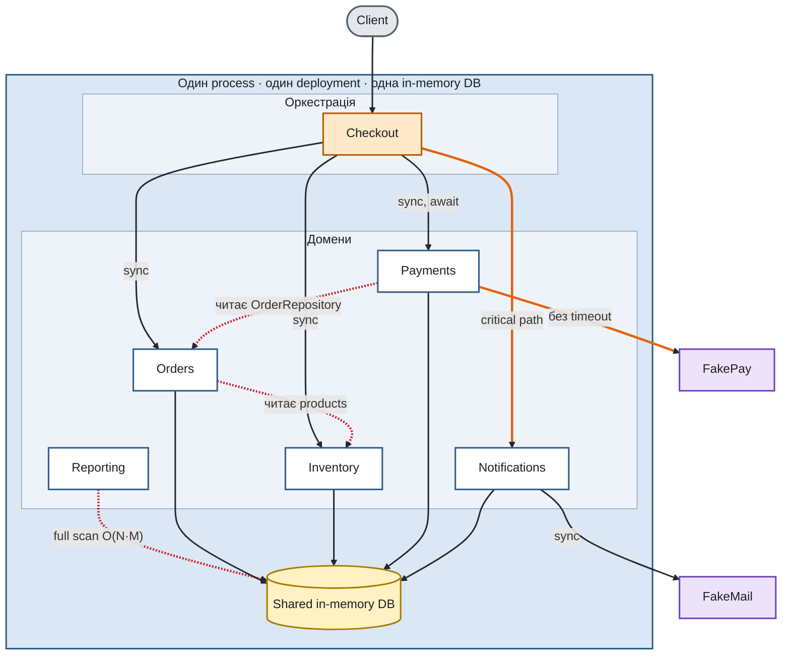
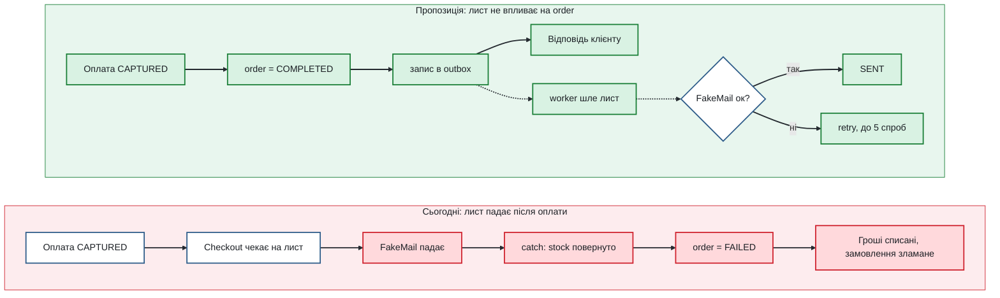
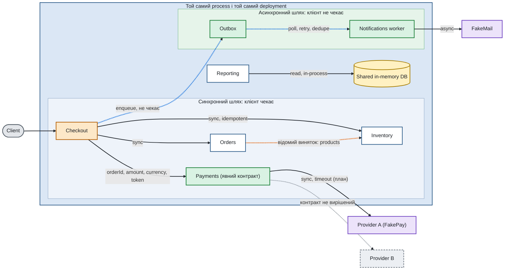
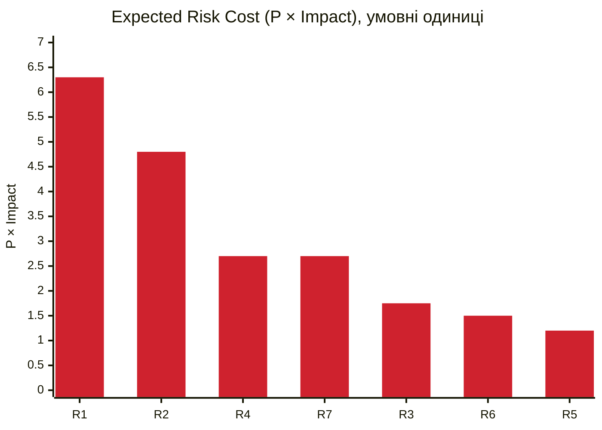
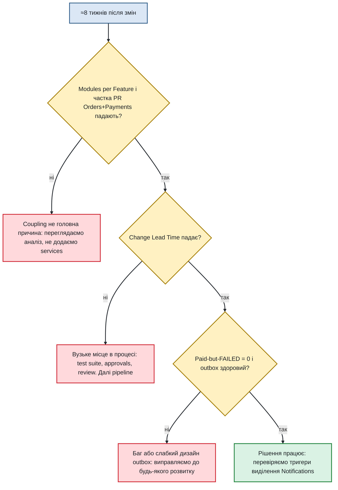
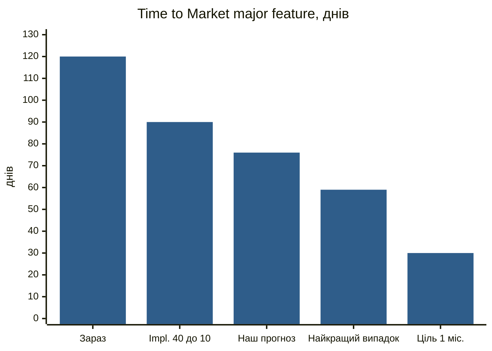

# OrderFlow: Architecture under Change

## Короткий виклад

OrderFlow залишається modular monolith. Розбиття на п'ять independent services не пропонується: проблеми системи пов'язані з нечіткими межами між модулями, а не з самим фактом спільного розгортання. Пропонується виправити дві межі, на яких зараз втрачаються час і коректність: між Payments і Orders та між Checkout і Notifications. Лист підтвердження виводиться з основного шляху оформлення замовлення, а правильність меж контролюється автоматично. Inventory свідомо залишається в тому самому process, бо єдина вимога, яку бізнес не допускає порушувати, — це відсутність overselling.

Для major feature реалістичний Time to Market становить близько 76 днів (2,5 місяця, діапазон 2–3 місяці). Місяць досяжний лише для першого інкременту feature, але не для всієї feature.

Усі зміни, описані нижче, є прогнозом імплементації. Код репозиторію не змінюється.

---

## 1. Опис системи

### 1.1 Призначення та склад

OrderFlow приймає замовлення на комп'ютерну техніку та безпосередньо впливає на виручку: коли checkout недоступний або повільний, частина покупців не завершує замовлення. Система працює три роки й побудована як modular monolith. Усі модулі виконуються в одному process, використовують спільну in-memory базу даних і розгортаються одним артефактом.

Модулі та їхні обов'язки:

- **Checkout** координує весь процес оформлення замовлення.
- **Orders** створює замовлення й змінює його статус.
- **Inventory** перевіряє наявність і резервує товар.
- **Payments** викликає зовнішній платіжний сервіс і зберігає платіж.
- **Notifications** формує та надсилає лист із підтвердженням.
- **Reporting** будує звіти про продажі та стан системи на основі операційних даних.

### 1.2 Як проходить оформлення замовлення

Клієнт надсилає запит на checkout. Checkout створює чернетку замовлення в Orders, резервує товар в Inventory, ініціює оплату в Payments, завершує замовлення в Orders і наприкінці надсилає лист через Notifications. Усі кроки виконуються послідовно й синхронно: клієнт отримує відповідь лише після завершення листа.

### 1.3 Зовнішні сервіси

Платіжний сервіс (FakePay) зазвичай відповідає за 100–300 мс, у 10% випадків за 1,5–3 с, і приблизно в 5% викликів повертає помилку. Поштовий сервіс (FakeMail) відповідає за 150–450 мс і за налаштуваннями відмовляє у 2% випадків.

### 1.4 Обмеження бізнесу й команди

- Команда складається з 8 engineers і 2 QA; окремої platform team немає.
- Система працює на одному instance з резервним.
- Зупинка розробки нових функцій заради перепису неприйнятна.
- Бюджет на інфраструктуру може зрости, якщо результат вимірюваний.
- Доступність checkout важливіша за швидкість листа з підтвердженням.
- Консистентність Inventory критична: overselling неприпустимий.

### 1.5 Поточна архітектура

Світло-синя область позначає один process і один deployment. Помаранчевий блок є оркестратором, білі блоки доменними модулями, жовтий базою даних, фіолетові зовнішніми сервісами. Червоні лінії позначають порушення меж і повне сканування даних, помаранчеві синхронні виклики зовнішніх сервісів, від яких залежить час відповіді клієнту.

---

## 2. Проблеми системи

### 2.1 Динаміка показників за шість місяців

Усі ключові показники погіршилися одночасно:

- Release Frequency знизилась із 5 до 2 релізів на тиждень.
- Change Lead Time зріс із 2 до 6 днів.
- Середній PR збільшився зі 180 до 520 LOC.
- Modules Changed per Feature зросла з 1,7 до 4,3.
- Rollback Rate зріс із 2% до 9%.
- Deployment Duration зросла з 8 до 27 хв.
- Кількість incidents зросла з 1 до 5 на місяць.
- MTTR зріс із 35 до 95 хв.

Ці показники фіксують наслідки, але не вказують на конкретну причину. Частина зростання Deployment Duration пов'язана з test suite та ручними погодженнями, тому не кожна проблема розв'язується архітектурою. Нижче перелічено конкретні проблеми, які підтверджено.

### 2.2 Оплачене замовлення може стати невдалим

Якщо надсилання листа завершується помилкою вже після успішного списання коштів, Checkout трактує це як збій усього замовлення: повертає товар на склад і переводить order у стан `FAILED`. Платіж при цьому лишається списаним (`CAPTURED`). У результаті клієнт отримує помилку, гроші списано, а товар знову доступний для продажу.

За налаштуваннями симулятора FakeMail така ситуація виникає у 2% оформлень. Це порушує водночас два пріоритети бізнесу: доступність checkout та консистентність Inventory.

### 2.3 Payments залежить від внутрішнього устрою Orders

Payments отримує repository модуля Orders і сам читає з нього замовлення, хоча потребує лише суму та валюту. Орієнтир дає статистика змін: 48% feature PR торкаються Orders і Payments одночасно, а Modules Changed per Feature зросла до 4,3.

### 2.4 Лист у критичному шляху

Checkout очікує завершення листа, тому швидкість і надійність поштового сервісу прямо впливають на відповідь клієнту. Шаблон листа розгортається разом із застосунком, і 37% змін шаблонів потребували повного regression checkout. Маркетинг запускає 2–3 експерименти із шаблонами на тиждень.

### 2.5 Оплата без timeout і з неповною ідемпотентністю

Виклик платіжного сервісу не має обмеження за часом, а два останні incidents збіглися з періодами підвищеної затримки провайдера. Крім того, захист від повторного списання враховує лише платежі зі статусом `CAPTURED`: два паралельні виклики оплати для одного order призводять до двох викликів provider і двох списань. Поточний Checkout сам не викликає оплату двічі для одного order, тому проблема проявиться при появі повторних спроб, timeout або другого provider.

### 2.6 Orders читає дані Inventory

Під час створення замовлення Orders напряму звертається до таблиці `products`, яка належить Inventory, щоб порахувати вартість. Це створює прихований зв'язок між модулями й ускладнить правила знижок (Scenario F).

### 2.7 Reporting у спільному event loop

Reporting сканує операційні дані в тому самому process, що й checkout, і шукає платіж та сповіщення для кожного замовлення лінійним проходом. Час побудови звіту зростає квадратично: близько 50 мс для 2 000 замовлень, близько 0,7 с для 10 000 і понад 5 с для 20 000 (вимірювання на тестових даних). Трафік Reporting зріс утричі за рік і може зрости в 8–10 разів за наступні 12 місяців.

### 2.8 Спільний deployment і процес

Усі модулі випускаються разом, в одному release, у спільні вікна двічі на тиждень. Є лише одне test environment, і черга на integration testing іноді становить 3–5 днів. Відкат повертає назад увесь release.

### 2.9 Що працює добре

Inventory реалізований коректно: резервування ідемпотентне (повторний reserve або release не змінює stock вдруге), перевірка та списання залишку виконуються синхронно без розриву. Ця частина системи не потребує змін.

---

## 3. Можливі шляхи розв'язання

### 3.1 Залишити архітектуру без змін і покращувати лише процес

Підхід не потребує інвестицій, але залишає помилку з розділу 2.2 та постійне зростання координаційних витрат. Він не змінює зв'язок між Orders і Payments.

### 3.2 Перейти до independently deployable services

Пропозиція передбачає перетворити Orders, Payments, Inventory, Notifications і Reporting на окремі сервіси. Вона усуває спільний deployment і дає ізоляцію збоїв зовнішніх сервісів. Водночас кожен сервіс потребує власних deployment, моніторингу та чергування, а в команди немає platform team. Мережеві виклики між модулями вводять часткові збої, потребують ідемпотентності та узгодження даних. Для Inventory це означало б розподілені операції з компенсаціями саме там, де бізнес не допускає помилок. Крім того, проблеми розділів 2.2–2.6 стосуються меж між модулями й залишилися б після розбиття у вигляді мережевих контрактів.

### 3.3 Зміцнити межі всередині modular monolith

Підхід виправляє підтверджені проблеми меж у межах існуючого deployment: Payments отримує явний контракт, лист виходить із критичного шляху, правильність меж перевіряється автоматично. Він не потребує нової інфраструктури, кожен крок можна відкотити окремо, а Inventory не змінюється. Обмеження підходу: спільний deployment і спільна черга релізів залишаються.

### 3.4 Вибір

Обрано шлях 3.3. Він єдиний із розглянутих, що прямо усуває помилку 2.2, не підвищує операційне навантаження на команду без platform team і не ставить під ризик консистентність Inventory.

Щодо чотирьох кроків пропозиції щодо services: перший крок (зафіксувати contracts між модулями) і другий (визначити data ownership та прибрати прямий доступ до чужих repositories) приймаються повністю. Третій крок (asynchronous messaging) приймається частково: лише outbox усередині process для листів, без брокера повідомлень. Четвертий крок (виділення services) перетворюється з плану на набір умов, наведений у розділі 11.

---

## 4. Ухвалене рішення

### 4.1 Що змінюємо

**Явний контракт Payments.** Метод оплати приймає `orderId`, суму в центах, валюту та платіжний token. Потрібні дані передає Checkout, тому Payments більше не залежить від устрою Orders.

**Outbox для листів.** Після завершення замовлення Checkout додає запис у чергу й одразу повертає відповідь клієнту. Окремий worker надсилає лист, повторює спробу до 5 разів і не допускає дублів завдяки ключу `orderId`. Помилка листа більше не може змінити статус оплаченого замовлення, а зміна шаблону не торкається checkout.

**Автоматичний захист меж.** У тестовий набір додається dependency test і поведінкові тести (розділ 10), які не дозволять повернути видалені залежності.

**Контракт payment provider, timeout і стан `UNKNOWN`.** Provider ховається за інтерфейсом, що готує систему до другого provider. Для виклику оплати вводиться timeout, а невизначений результат фіксується окремим станом. Ці кроки вказані як план, їх деталі в розділі 13.

### 4.2 Що залишаємо без змін

- **Один process, одну DB і один deployment.** Проблеми, що потребують виправлення, лежать у межах між модулями, а не в спільному розгортанні.
- **Inventory в тому самому process.** Резервування виконується синхронно й ідемпотентно. Винесення потребувало б розподілених операцій із компенсаціями, тобто підвищило б ризик overselling, який бізнес не допускає.
- **Синхронну оплату в checkout.** Клієнт має отримати результат оплати відразу. Змінюється межа модуля, але не характер виклику.
- **Reporting у process.** Шкоди для checkout від нього наразі не зафіксовано. Умови виділення подані в розділі 11.
- **Читання `products` модулем Orders.** Це свідомий виняток, доки не визначено, хто володіє ціною та правилами знижок.

### 4.3 Чому складніша архітектура поки не потрібна

Команда з 8 engineers і 2 QA не має platform team, а MTTR уже зріс із 35 до 95 хв, тож додатковий on-call для кожного сервісу погіршив би ситуацію. Виявлені проблеми стосуються меж, а не розгортання, і не зникають при розбитті. Частина проблем delivery пов'язана з процесом: test suite, ручні погодження, єдине test environment. Orders, Payments і Inventory потребують сильної консистентності, яку простіше гарантувати в одному process.

### 4.4 Компроміси

Лист може надійти пізніше або після повторної спроби, що допустимо за вимогами бізнесу. З'являються новий код outbox і worker та нові види відмов: черга, дублікати, втрата запису без персистентного сховища. Спільний deployment зберігається, тому зміна будь-якого модуля й надалі розгортає весь застосунок, а Reporting і Notifications не масштабуються окремо. Натомість checkout перестає залежати від поштового сервісу, Payments змінюється без залучення Orders, а операційні витрати не зростають.

### 4.5 Критерії успіху

Modules Changed per Feature знижується з 4,3 до значення менше 2,5. Частка PR, що торкаються Orders і Payments, знижується з 48% до 25% або менше. Кількість оплачених замовлень зі статусом `FAILED` дорівнює нулю. Частка змін шаблонів, що потребують повного regression checkout, знижується з 37% до менш ніж 5%. Change Lead Time знижується з 6 до 3 днів або менше. Повний перелік метрик і умов, за яких рішення вважається недостатнім, наведений у розділі 10.

---

## 5. Архітектура після змін

Deployment boundary не змінюється: один process, одна DB, один artifact. Система розділяється на два шляхи виконання. Клієнт очікує лише на синхронний шлях, а надсилання листа відбувається асинхронно.

Світло-синя область позначає той самий deployment. Зелені блоки та підобласть є новими компонентами (контракт Payments, outbox, worker). Сині пунктирні лінії позначають асинхронні виклики, сірий пунктирний блок і лінія є планом для другого provider, помаранчева лінія позначає збережений виняток читання `products` модулем Orders.

---

## 6. Пріоритети та принципи

### 6.1 Пріоритети

Характеристики впорядковано так: надійність і консистентність даних, доступність checkout, зручність зміни (modifiability), простота експлуатації, швидкість розгортання, масштабування Reporting.

Заради цих пріоритетів ми приймаємо:
- пізнішу доставку листа заради доступності checkout;
- відсутність незалежного deployment заради простоти експлуатації;
- слабшу ізоляцію збоїв на рівні process (збій process зачіпає всю систему, резервний instance компенсує це частково);
- відсутність окремого масштабування Reporting, доки воно не потрібне.

### 6.2 Принципи

**Information Hiding.** Payments не повинен знати, як Orders зберігає й читає дані. Зараз він тримає repository Orders; після змін отримує лише необхідні значення.

**Explicit Contracts.** Взаємодія модулів відбувається через іменовані контракти: метод оплати з явними параметрами та запис outbox підтвердження замовлення. Ціна принципу: контракти потрібно підтримувати й версіонувати.

**Dependency Direction.** Залежності спрямовані від оркестратора до модулів, а не між модулями. Зараз Payments залежить від Orders, а Checkout від Notifications; після змін таких залежностей немає. Ціна: Checkout бере на себе збирання даних для Payments.

**Fitness Functions.** Правильність меж перевіряється автоматично в тестовому наборі. Ціна: тест потребує явного списку винятків і може створювати зайві спрацювання, якщо ці винятки не підтримувати.

---

## 7. Бізнес-сценарії

**A. Часті зміни Notifications (2–3 на тиждень).** Після виділення outbox зміна шаблону лишається в межах Notifications і не потребує повного regression checkout. Швидко вимкнути експеримент без release поки неможливо; для цього шаблони та вимикач слід зберігати як дані (розділ 9).

**B. Другий payment provider.** Контракт provider дозволяє підключити новий adapter без змін в Orders і Checkout. Модель асинхронного підтвердження платежу не розроблялася, бо вимоги до неї ще не визначені.

**C. Зростання Reporting у 8–10 разів.** Reporting лишається в process, лінійний пошук замінюється індексом, а окреме сховище вводиться за умовами розділу 11. Допустима затримка даних у кілька хвилин дозволяє перейти на read model пізніше без змін для користувачів.

**D. Ідемпотентність Inventory.** Вимога вже виконана: повторні reserve і release не змінюють stock повторно, і це покрито тестом.

**E. Доступність checkout.** Лист виходить із критичного шляху, тож його затримка або недоступність поштового сервісу не впливає на checkout. Для платіжного provider запланований timeout зі швидким завершенням і станом `UNKNOWN`.

**F. Нове правило знижок.** Питання не вирішене повністю: Orders зараз читає ціни безпосередньо з даних Inventory. Потрібне окреме рішення про те, хто володіє ціною та правилами знижок, і про те, як знижка відображається в Reporting.

---

## 8. Ризики

Грошових оцінок і обсягів трафіку в наявних матеріалах немає, тому Expected Risk Cost розраховано в умовних одиницях. Probability означає оцінку ймовірності принаймні одного значущого випадку за квартал, Impact оцінюється за шкалою від 1 до 10. Розрахунок: Expected Risk Cost = Probability × Impact. Значення є оцінками й підлягають уточненню.

**R1. Помилка листа після оплати.** Order стає `FAILED`, товар повертається в продаж, платіж лишається списаним. Probability 0,9; Impact 7; Expected Risk Cost 6,3. Mitigation: outbox та поведінковий тест «поштовий сервіс недоступний, order лишається `COMPLETED`».

**R2. Затримка або недоступність payment provider.** Затримка до 3 с блокує checkout, а timeout відсутній. Probability 0,6; Impact 8; Expected Risk Cost 4,8. Mitigation: timeout зі швидким завершенням та метрика p95 часу відповіді provider.

**R4. Невизначений стан оплати після timeout (ризик, який створює саме це рішення).** Після timeout provider міг списати кошти, а система вже зафіксувала невдачу. Повторна спроба спричинить подвійне списання. Probability 0,3; Impact 9; Expected Risk Cost 2,7. Mitigation: значення timeout більше за максимальну затримку provider (понад 3 с), стан `UNKNOWN` замість `FAILED`, відсутність автоматичного повтору списання, звірка зі станом у provider.

**R7. Подвійне списання через неповну ідемпотентність.** Захист не охоплює стан `PROCESSING`, тому паралельні виклики оплати для одного order призводять до двох списань. Зараз проблема прихована, але проявиться разом із повторними спробами, timeout або другим provider. Probability 0,3; Impact 9; Expected Risk Cost 2,7. Mitigation: guard для стану `PROCESSING` на боці Payments. R4 і R7 мають однакову оцінку й закриваються одним механізмом: станом `UNKNOWN` та охороною від повторного списання.

**R3. Зростання Reporting.** Збільшення навантаження в 8–10 разів може блокувати спільний event loop і затримувати checkout. Це ціна рішення не виділяти Reporting. Probability 0,25; Impact 7; Expected Risk Cost 1,75. Mitigation: індекс замість лінійного пошуку, спостереження за кореляцією p95 checkout із запитами на звіти, виділення за умовами розділу 11.

**R6. Хибне відчуття безпеки від dependency test (ризик, який створює саме це рішення).** Межі можуть залишатися чистими формально, тоді як залежність переміщується до спільних структур даних. Probability 0,3; Impact 5; Expected Risk Cost 1,5. Mitigation: оцінювати результат ще й за метриками розділу 10, а не лише за проходженням тесту. Показово, що поточний зв'язок Payments→Orders реалізований через передачу repository в конструктор, а не через `import`, тому перевірка лише імпортів його б не виявила.

**R5. Дублювання та втрата записів outbox (ризик, який створює саме це рішення).** Повторні спроби можуть дублювати лист, а збій process без персистентного сховища призводить до втрати запису без сліду. Probability 0,4; Impact 3; Expected Risk Cost 1,2. Mitigation: ключ дедуплікації `orderId`, метрики віку найстаршого запису та кількості повторів, персистентне сховище для production.

Найвищі Expected Risk Cost мають R1 і R2: це поточні проблеми, які виправдовують запропоновані зміни. Найістотнішим ризиком, який створює саме рішення, є R4: timeout знижує R2, але вводить R4, тому користь від timeout залежить від того, чи реалізовано mitigation. R3 є свідомою ціною відмови від виділення Reporting, тому розділ 11 визначає, за яких умов ця відмова перестає бути обґрунтованою.

---

## 9. Вартість однієї зміни

Для аналізу взято типову зміну: новий експеримент зі шаблоном листа, який може знадобитися швидко вимкнути (Scenario A). Для розрахунку використано умовну вартість години $50. Базовий варіант для порівняння: та сама зміна після відокремлення Notifications. Кількість годин є оцінкою.

**Зараз: приблизно 16 год ($800).**
- Реалізація 3 год.
- Координація 3 год: потрібне узгодження з власниками Checkout, Orders, Payments і з календарем deployment.
- Тестування 6 год: у 37% випадків потрібен повний regression checkout (10 год), в інших 63% достатньо 3 год.
- Release 4 год.
- Редагується один модуль (Notifications), але до перевірки потрапляють 3–4 модулі.

**Після змін: приблизно 8 год ($400).**
- Реалізація 3 год.
- Координація 1 год: один модуль і один власник.
- Тестування 2 год: тести Notifications та автоматичні перевірки меж.
- Release 2 год.
- До перевірки потрапляє лише Notifications.

Різниця: $400 на одну зміну. За 8,7–13 змін на місяць це приблизно $3,5–5,2 тис. Оцінка має похибку близько 30%.

Що не змінюється: deployment лишається спільним, тобто навіть зміна шаблону розгортає весь застосунок. Швидко вимкнути експеримент без release також неможливо. Наступним кроком може стати зберігання шаблонів і вимикача як даних: тоді зміна не потребуватиме release, але потрібні будуть валідація шаблонів, версіонування та контроль доступу до листів, що йдуть клієнтам.

Для перевірки оцінки слід порівняти п'ять останніх PR зі зміною шаблону з п'ятьма першими після впровадження: кількість модулів, час до production, наявність повного regression. Якщо різниця менша за 30%, оцінку слід вважати завищеною.

---

## 10. Метрики та перевірки меж

### 10.1 Метрики

Значення подані як цілі. Горизонт вимірювання: приблизно 8 тижнів, або 16 релізів.

- **Modules Changed per Feature.** Зараз 4,3, ціль менше 2,5. Рішення недостатнє, якщо показник залишається на рівні 4,0 або вище.
- **Частка PR, що торкаються Orders і Payments.** Зараз 48%, ціль не більше 25%. Рішення недостатнє, якщо частка залишається вище 40%.
- **Оплачені замовлення зі статусом `FAILED`.** Мають зникнути. Будь-який випадок після впровадження означає помилку рішення.
- **Change Lead Time для PR зі зміною шаблонів.** Зараз 6 днів, ціль не більше 3. Якщо показники зв'язності модулів покращилися, а Lead Time ні, головне обмеження лежить у процесі: тестах, погодженнях, ревʼю.
- **Частка змін шаблонів із повним regression.** Зараз 37%, ціль менше 5%. Рішення недостатнє, якщо після введення outbox показник залишається вище 15%.
- **Стан outbox.** Вік найстаршого запису та кількість повторів мають бути малими й стабільними. Рішення недостатнє, якщо втрачається або дублюється понад 0,5% листів чи затримка черги перевищує 15 хв.
- **Час відповіді checkout (p95).** Спершу фіксується базовий рівень під навантаженням звітів і за затримки provider 3 с. Якщо показник корелює із запитами на звіти, Reporting виділяється раніше.
- **Тривалість Integration і Validation у першій major feature.** Прогноз 19 і 18 днів. Рішення недостатнє, якщо Integration перевищує 20 днів або черга на test environment лишається 3–5 днів.

Rollback Rate (ціль менше 4%), Deployment Duration, Incidents і MTTR відстежуються як супутні показники. Вони залежать і від процесу, тому не використовуються для оцінки меж рішення.

### 10.2 Автоматичні перевірки

**Dependency test.** Кожен модуль імпортує лише власні файли та спільні утиліти. Кожен модуль звертається лише до дозволених колекцій даних. Payments не згадує repository Orders. Єдиний дозволений виняток: читання `products` модулем Orders. Перевірка втрачає цінність, якщо кількість винятків перевищує 3 за квартал або якщо тест зелений, а Modules Changed per Feature не знижується.

**Поведінковий тест відмови листа.** Коли поштовий сервіс недоступний, order лишається `COMPLETED`, платіж `CAPTURED`, а запис залишається в outbox і повторюється. Перевірка втрачає цінність, якщо тест зелений, а в production все одно трапляються оплачені замовлення зі статусом `FAILED`.

**Тест ідемпотентності.** Повторне додавання запису в outbox і повторна обробка черги не дублюють лист. Для Inventory аналогічний тест уже існує.

### 10.3 Як інтерпретувати результат

Через 8 тижнів перевіряється, чи знижуються Modules Changed per Feature і частка PR Orders+Payments. Якщо ні, аналіз причин зв'язності переглядається без додавання сервісів. Якщо так, оцінюється Change Lead Time: його відсутність вказує на обмеження в процесі. Далі перевіряється, що кількість оплачених замовлень зі статусом `FAILED` дорівнює нулю і outbox працює стабільно. Лише тоді розглядаються умови виділення Notifications.

---

## 11. Що відхилено, що лишається та коли ускладнювати

**Відхилено.** Перехід усіх п'яти модулів до independently deployable services. Прийнято лише кроки, що виправляють межі (контракти, власність даних, outbox для листів). Також відхилено ціль «1 місяць» для всієї major feature.

**Лишається без змін.** Один process і одна DB; Inventory поряд з Orders і Checkout; синхронна оплата; Reporting у process; читання `products` модулем Orders як визнаний виняток.

**Коли розглядати складнішу архітектуру.**

- **Notifications як окремий deployment.** За одночасного виконання трьох умов: dependency test стабільно зелений, а контракт outbox не змінюється кілька релізів; є метрики та сповіщення про стан черги й призначена відповідальна особа на чергуванні; після змін першої фази Notifications усе ще лишається обмеженням для Change Lead Time або Release Frequency. Без outbox і моніторингу окремий сервіс успадкував би ту саму помилку з розділу 2.2.
- **Reporting з read model або окремим сховищем.** Якщо час відповіді checkout починає корелювати із запитами на звіти або навантаження наближається до рівня 8–10 разів від поточного.
- **Payments як окремий сервіс.** Якщо підключено другий provider або правила fraud змінюються частіше, ніж випускається решта системи, і є моніторинг та чергування.
- **Orders та Inventory.** Не виділяються за умов, які видно зараз: вони потребують сильної консистентності.
- **Повний перегляд рішення.** Якщо Modules Changed per Feature залишається на рівні 2,5 або вище після виправлення меж.

---

## 12. AI та Time to Market

### 12.1 Перевірка очікування «1 місяць»

Поточний цикл major feature складається з п'яти етапів: Analysis 20 днів, Implementation 40, Integration 25, Validation 25, Release 10, разом 120 днів. Очікування, що AI-інструменти скоротять цикл до 1 місяця, ґрунтується на припущенні, що розробка прискориться вчетверо.

Якщо справді скоротити лише Implementation із 40 до 10 днів, Time to Market становитиме 90 днів, а не 30. Навіть за нульової тривалості Implementation залишилося б 80 днів: цей етап становить лише третину циклу.

### 12.2 Прогноз за етапами

Прогноз враховує, що покращення можуть частково перетинатися, тому ґрунтується на помірних значеннях, а не на крайніх межах.

- **Analysis: 20 → 17 днів.** AI допомагає з дослідженням і швидким прототипом, але етап залежить від доступності stakeholders.
- **Implementation: 40 → 15 днів.** Головний виграш від AI. Нижню межу обмежують пропускна здатність review та якість згенерованого коду.
- **Integration: 25 → 19 днів.** Зменшення на 6 днів дають явні контракти між модулями, дрібніші changesets і contract tests. Єдине test environment залишається, тому більшого скорочення не очікується.
- **Validation: 25 → 18 днів.** Зменшення на 7 днів можливе після появи другого test environment та автоматизації.
- **Release: 10 → 7 днів.** Дають частіші вікна release. Незалежний deployment ми свідомо не вводимо, тому більшого виграшу не буде.

Разом: 17 + 15 + 19 + 18 + 7 = **76 днів, або приблизно 2,5 місяця** (діапазон 2–3 місяці). Це досяжно через 1–2 квартали інвестицій; перша major feature виграє менше через одноразові витрати на перехід. Найкращий можливий результат за оцінками команди, якщо взяти найбільше скорочення на кожному етапі, становить 59 днів, або 51% скорочення циклу.

### 12.3 Чи реалістичний місяць

Для всієї major feature ні. Щоб вкластися у 30 днів, цикл потрібно скоротити на 75%, тоді як навіть найкращий варіант за оцінками команди дає 51%. Місяць досяжний лише для першого інкременту feature, який випускається за feature flag.

Щоб місячний цикл став можливим, мають змінитися такі умови:
- feature розбивається на малі інкременти, що проходять увесь цикл окремо;
- етапи частково виконуються паралельно, а не лише послідовно;
- з'являється друге test environment, бажано створюване на вимогу;
- між модулями діють contract tests;
- релізи відбуваються частіше, ніж двічі на тиждень, або окремо по модулях;
- знання про архітектуру розподіляються між більшою кількістю людей, ніж двоє senior engineers (ADR, відповідальні за модулі);
- рішення на етапі analysis ухвалюються у визначені строки.

### 12.4 Що обмежує прискорення

Генерація коду прискорює лише Implementation. Далі обмеженнями стають процесні чинники: єдине test environment з чергою 3–5 днів, ревʼю, яке залежить від двох senior engineers, ручне ревʼю змін щодо безпеки та фінансів, відсутність базових показників якості коду, створеного з AI. До цього додаються архітектурні чинники: спільні вікна release двічі на тиждень, зміни всіх модулів в одному release, зв'язність модулів (4,3 модуля на feature, PR близько 520 LOC).

### 12.5 Нові ризики від зростання швидкості написання коду

Ревʼю стає вузьким місцем, розмір PR продовжує зростати, якість коду, створеного з AI, невідома, а такий код швидше порушує межі, тому автоматичні перевірки з розділу 10 набувають більшого значення. Більші пакети змін у release збільшують наслідки збою та Rollback Rate. Черга на test environment погіршується.

### 12.6 Як вимірювати вплив AI

Не за кількістю рядків або PR, а за тривалістю кожного етапу, часом очікування ревʼю, часткою PR, що чекають понад визначений строк, частотою переробок, кількістю дефектів, що дійшли до production, та Change Failure Rate окремо для PR з AI і без нього.

### 12.7 Що змусить переглянути прогноз після першої major feature

Implementation триває понад 20 або менше 10 днів; черга на integration залишилась 3–5 днів; час очікування ревʼю не знизився; частка дефектів у коді з AI вища за решту; фактичний цикл перевищує 87 днів.

---

## 13. Прогноз імплементації

Розділ описує, що і в якому порядку потрібно виконати. У репозиторій зміни не вносяться. Мета полягає в тому, щоб показати здійсненність рішення малими кроками без зупинки розробки.

1. **Тест на помилку.** Додається тест «поштовий сервіс недоступний, order `COMPLETED`, платіж `CAPTURED`»; на поточній системі він не проходить. Відкат: видалення тесту.
2. **Outbox.** Checkout додає запис у чергу після завершення замовлення поза обробником помилок. Notifications отримує додавання записів, worker із повторними спробами та дедуплікацією за `orderId`. Reporting показує стан листа. Критерій прийняття: тест кроку 1 проходить, повторне додавання не дублює запис. Відкат: повернення синхронного очікування листа й видалення worker.
3. **Контракт Payments.** Оплата приймає `orderId`, суму, валюту й token; Checkout передає ці значення. Критерій прийняття: Payments працює без жодних даних Orders, repository Orders у ньому не згадується. Відкат: повернення параметра repository в конструктор.
4. **Dependency test** з явним списком винятків. Критерій прийняття: проходить після кроку 3 і не проходить на поточній системі. Відкат: вимкнення тесту.
5. **Метрики.** Вік найстаршого запису outbox, кількість повторів, p95 часу відповіді checkout та provider. Критерій прийняття: показники доступні без ручної роботи.
6. **Timeout, стан `UNKNOWN`, захист стану `PROCESSING`, звірка зі станом provider** (ризики R4 і R7). Критерій прийняття: два паралельні виклики оплати дають одне списання, а невизначений результат не повертає товар на склад. Відкат: через feature flag.
7. **За бажанням:** індекс для Reporting; шаблони листів і вимикач як дані. Критерій прийняття: час звіту не зростає квадратично; зміна шаблону не потребує release.

Кроки 1–5 виконуються за принципом «спершу тест, потім зміна». Крок 6 складніший: його деталі залежать від поведінки реального payment provider, тому він виконується останнім і не блокує інші.

Рішення, від яких залежить повна реалізація: чи підтримує реальний payment provider ключ ідемпотентності; яке сховище даних використовується в production (in-memory база втрачає чергу outbox при перезапуску, тому для production потрібне персистентне сховище); хто володіє ціною та правилами знижок (Scenario F).
